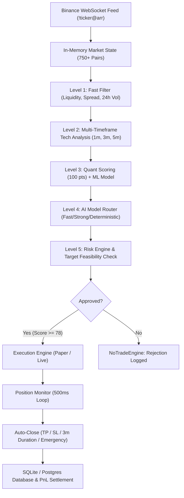

# System Architecture & Technical Specifications

## 1. Multi-Layer Decision Hierarchy



---

## 2. Low-Latency Pipeline Optimizations
1. **Zero REST Tick Polling**: Binance `!ticker@arr` WebSocket multiplexer continuously streams entire USDT market universe in memory without REST rate limiting.
2. **Vectorized Indicator Suite**: Moving averages, Bollinger bands, ATR, and RSI are computed using C-level NumPy vectorization.
3. **Multi-Stage Funnel**: Only the top 25 tokens advance to multi-timeframe candle fetches; only the top 10 receive ML probability estimation; only the top 3 receive AI validation.
4. **Deterministic Quant Fallback**: If OpenAI rate limits or network latency exceeds 8 seconds, the engine seamlessly resolves using the deterministic rule validator without interrupting the trading loop.

---

## 3. Quantitative Scoring Weights (100 Points)
- **Trend Alignment (15 pts)**: EMA 9 > EMA 21 > EMA 50 + Price above VWAP.
- **Momentum (15 pts)**: RSI between 48 and 68, MACD positive histogram, Stoch RSI turning upward.
- **Volume Expansion (15 pts)**: Relative Volume (RVOL) > 1.3, volume expansion on active candles.
- **Volatility (10 pts)**: Normalized ATR between 0.20% and 1.2%, Bollinger bandwidth expanding.
- **VWAP Geometry (10 pts)**: Shallow bounce or holding above VWAP.
- **Order Book Imbalance (15 pts)**: Bid/Ask pressure imbalance >= 0.60, spread <= 0.04%.
- **Market Structure (10 pts)**: Resistance breakout or clean bounce off recent pivot support.
- **Multi-Timeframe Confirmation (10 pts)**: 3m and 5m trend confirming 1m scalp direction.

---

## 4. State Machine Sequence
```
SCANNING 
  ↓
CANDIDATE_DETECTED 
  ↓
FAST_ANALYSIS 
  ↓
TECHNICAL_ANALYSIS 
  ↓
ML_ANALYSIS 
  ↓
ORDER_FLOW_ANALYSIS 
  ↓
MARKET_REGIME 
  ↓
AI_VALIDATION 
  ↓
RISK_VALIDATION 
  ↓
TRADE_APPROVED  (or NO_TRADE)
  ↓
EXECUTION 
  ↓
POSITION_OPEN 
  ↓
POSITION_MONITORING 
  ↓
EXIT_DECISION 
  ↓
AUTO_CLOSE 
  ↓
PNL_CALCULATION 
  ↓
TRADE_COMPLETE
```
